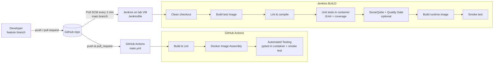

# ACEest Fitness & Gym — Flask App with Automated CI/CD

[](https://github.com/2025tm93235/aceest-fitness-devops/actions/workflows/main.yml)


A Flask web application for ACEest Fitness & Gym (client management, training
programs, progress tracking, workouts, body metrics, BMI and program generation)
with an automated build, test and delivery workflow:

**Git/GitHub → Pytest → Docker → Jenkins BUILD → GitHub Actions CI**

The application is a web port of the baseline Tkinter scripts
(`legacy/`, v1.0 → v3.2.4). See [legacy/README.md](legacy/README.md) for how
each baseline version maps to the Flask features and which baseline defects
were fixed.

---

## Contents

1. [Features](#1-features)
2. [Project structure](#2-project-structure)
3. [Local setup and execution](#3-local-setup-and-execution)
4. [Running the tests manually](#4-running-the-tests-manually)
5. [Running with Docker](#5-running-with-docker)
6. [CI/CD overview: Jenkins and GitHub Actions](#6-cicd-overview-jenkins-and-github-actions)
7. [API reference](#7-api-reference)
8. [Configuration](#8-configuration)
9. [Branching and commit conventions](#9-branching-and-commit-conventions)

---

## 1. Features

| Area | What it does | Baseline |
|---|---|---|
| Program catalogue | 4 programs with weekly workout and nutrition plans | v1.0, v1.1, v2.2.4 |
| Calculators | Daily calories (weight × program factor), BMI with risk category | v1.1, v2.2.4 |
| Clients | Create, list, update, rename, delete; calories recalculated automatically | v1.1 – v2.2.4 |
| Progress | Weekly adherence log, average adherence, client summary | v2.0 – v2.2.4 |
| Workouts | Sessions with exercises (sets, reps, weight), history | v2.2.4 |
| Body metrics | Weight, waist, body fat over time; client BMI | v2.2.4 |
| Program generator | Rule-based plan by experience level; seedable for repeatable output | v3.1.2 |
| Membership | Status and renewal date; memberships past their end date show as *Expired* | v3.2.4 |
| Login | Session login, hashed passwords, protected API and pages | v3.1.2, v3.2.4 |

The app offers both a **JSON REST API** (`/api/...`) and **HTML pages**
(dashboard, client page, programs).

## 2. Project structure

```text
aceest-fitness-devops/
├── app.py                    # WSGI entry point (python app.py / gunicorn app:app)
├── aceest/                   # Application package
│   ├── __init__.py           # create_app() factory
│   ├── config.py             # Environment-driven configuration
│   ├── db.py, schema.sql     # SQLite connection handling + idempotent schema
│   ├── auth.py               # Password hashing, login guard, admin bootstrap
│   ├── catalog.py            # Training program catalogue
│   ├── services.py           # Pure business logic (calories, BMI, generator, membership)
│   ├── repository.py         # Data access for clients, progress, workouts, metrics
│   ├── validation.py         # Shared input validation
│   ├── errors.py             # JSON / HTML error handling
│   ├── api/                  # REST API blueprint (/api/...) + /health
│   ├── web/                  # HTML views (Jinja2) with CSRF protection
│   ├── templates/, static/   # Pages and stylesheet
├── tests/                    # Pytest suite (unit + API + web)
├── legacy/                   # Baseline Tkinter scripts (reference only)
├── scripts/smoke_test.sh     # Container smoke test shared by Jenkins and Actions
├── Dockerfile, .dockerignore # Multi-stage, non-root container build
├── Jenkinsfile               # Jenkins BUILD pipeline
├── .github/workflows/main.yml# GitHub Actions CI pipeline
├── sonar-project.properties  # Optional SonarQube analysis settings
├── requirements.txt          # Pinned runtime dependencies
├── requirements-dev.txt      # + pytest, pytest-cov, ruff
├── pyproject.toml            # ruff, pytest and coverage configuration
└── docs/                     # Jenkins VM setup guide, screenshots
```

## 3. Local setup and execution

**Prerequisites:** Git and Python **3.10 or newer** (3.13 recommended), or
Docker (see [section 5](#5-running-with-docker)).

> The lab VM's system Python (3.9) is too old for the pinned dependencies.
> On the VM, use Docker, or install a newer Python (`sudo dnf install python3.12`).

```bash
git clone https://github.com/2025tm93235/aceest-fitness-devops.git
cd aceest-fitness-devops

python3 -m venv .venv
source .venv/bin/activate          # Windows PowerShell: .venv\Scripts\Activate.ps1
pip install -r requirements-dev.txt

# optional but recommended
export ACEEST_ADMIN_PASSWORD='choose-a-password'    # PowerShell: $env:ACEEST_ADMIN_PASSWORD='...'
export ACEEST_SECRET_KEY="$(python -c 'import secrets; print(secrets.token_hex(32))')"

python app.py
```

Open <http://127.0.0.1:5000> and log in as `admin` with the password you set.
If `ACEEST_ADMIN_PASSWORD` is not set, the legacy default `admin` is used and a
warning is logged. The SQLite database is created at `instance/aceest.db`.

Quick API check:

```bash
curl http://127.0.0.1:5000/health
curl http://127.0.0.1:5000/api/programs
```

## 4. Running the tests manually

With the virtual environment active:

```bash
pytest                          # full suite + coverage report (fails below 90%)
pytest tests/test_services.py   # a single module
pytest -k bmi -v                # tests matching a keyword
ruff check .                    # lint (pycodestyle, pyflakes, bugbear, bandit, ...)
ruff format --check .           # formatting
```

Coverage settings live in `pyproject.toml` (`--cov-fail-under=90`, branch
coverage). Each test gets its own temporary SQLite database, so tests are
isolated and can run in any order.

The suite covers:

- **Unit tests** — calories, BMI category boundaries, program generator rules,
  membership expiry, input validation.
- **API tests** — every endpoint, including authentication (401), validation
  (400), not found (404), conflicts (409) and cascading deletes.
- **Web tests** — login and redirects, CSRF rejection, all forms, error pages.

Running the tests **inside the container** (exactly what CI and Jenkins do):

```bash
docker build --target test -t aceest-fitness:test .
docker run --rm aceest-fitness:test                     # pytest
docker run --rm aceest-fitness:test ruff check .        # lint
```

## 5. Running with Docker

```bash
docker build -t aceest-fitness .
docker run -d --name aceest -p 5000:5000 \
  -e ACEEST_ADMIN_PASSWORD='choose-a-password' \
  -e ACEEST_SECRET_KEY="$(openssl rand -hex 32)" \
  -v aceest-data:/app/instance \
  aceest-fitness
docker ps          # STATUS shows (healthy) once /health responds
```

How the Dockerfile keeps the image small and secure:

| Practice | Implementation |
|---|---|
| Small base | `python:3.13-slim-trixie` |
| Multi-stage build | `builder` installs dependencies into `/opt/venv`; `runtime` copies only the venv, `app.py` and `aceest/` (no compilers, tests, pip cache or dev tools) |
| Layer caching | `requirements.txt` is copied and installed before the source code |
| Minimal build context | Allow-list `.dockerignore` (only the files the build needs) |
| Non-root | Runs as system user `aceest` (UID 10001); app code is owned by root and read-only |
| Pinned dependencies | Every runtime package pinned in `requirements.txt` |
| Production server | gunicorn (2 workers, `--preload`) instead of the Flask dev server |
| Health check | `HEALTHCHECK` calls `/health`, using Python only (no curl in the image) |
| No baked secrets | Secret key and admin password come from environment variables |

A separate `test` target (builder + dev tools + tests) is used by CI and
Jenkins, so the tests run in the same environment as production while the
production image stays free of test tooling.

## 6. CI/CD overview: Jenkins and GitHub Actions



Both pipelines use the **same Dockerfile, test target and smoke-test script**,
so a green result means the same thing in both places.

### GitHub Actions (`.github/workflows/main.yml`)

Triggered on **every push (any branch) and every pull request**, and manually
(`workflow_dispatch`). Three jobs run in sequence; if one fails, the later
ones do not run:

| Job | Steps |
|---|---|
| **Build & Lint** | Set up Python 3.13 (pip cache) → install `requirements-dev.txt` → `python -m compileall` (syntax check) → `ruff check` → `ruff format --check` → import the app to confirm it starts |
| **Docker Image Assembly** | Buildx builds the `runtime` and `test` targets (layer cache stored in GitHub Actions) and passes both images to the next job as an artifact |
| **Automated Testing** | Loads the images, runs `pytest` **inside the test container**, uploads JUnit and coverage XML as artifacts, then starts the runtime image and smoke-tests `/health` |

The workflow uses read-only repository permissions and cancels superseded
runs on the same branch.

### Jenkins (`Jenkinsfile`)

Jenkins runs on the lab VM (Rocky Linux 9) as a second check in a controlled
build environment. The job is a **Pipeline from SCM** that reads the
`Jenkinsfile` from the `main` branch:

1. **Checkout**: deletes the workspace and clones the latest commit, so every build starts clean.
2. **Build Environment**: `docker build --pull --target test` (always uses the latest patched base image).
3. **Lint & Compile**: `compileall`, `ruff check` and `ruff format --check` inside the container.
4. **Unit Tests**: pytest inside the container; `junit.xml` and `coverage.xml` are copied out, published as JUnit results and archived.
5. **SonarQube Analysis / Quality Gate** (optional, `RUN_SONAR` parameter): static analysis plus coverage; the build fails if the Quality Gate fails.
6. **Build Runtime Image**: tagged with the build number and `latest`.
7. **Smoke Test**: starts the container and waits for `/health` to return 200.
8. **Image Report**: prints the image user and size. The post-build step removes temporary containers and images.

**Trigger:** `pollSCM('H/2 * * * *')`. Jenkins checks GitHub about every
2 minutes and builds only when there is a new commit. This works without
opening the VM to the internet. (If GitHub can reach Jenkins, you can switch
to a GitHub webhook with `githubPush()`.)

Everything runs in Docker, so the agent only needs Git and Docker, and the
host Python version does not matter. Full VM setup steps:
[docs/JENKINS_SETUP.md](docs/JENKINS_SETUP.md).

### Quality gates at a glance

| Gate | GitHub Actions | Jenkins |
|---|---|---|
| Syntax (compileall) | ✔ | ✔ |
| Lint + format (ruff, incl. security rules) | ✔ | ✔ |
| Unit/API/web tests (pytest, in container) | ✔ | ✔ |
| Coverage ≥ 90 % | ✔ | ✔ |
| Docker image builds | ✔ | ✔ |
| Container becomes healthy | ✔ | ✔ |
| SonarQube Quality Gate | – | optional |

## 7. API reference

`🔒` = requires login (session cookie from `POST /api/auth/login`).
Errors are returned as `{"error": "...", "details": {field: message}}`.

| Method | Path | Description |
|---|---|---|
| GET | `/health` | Liveness and database check |
| POST | `/api/auth/login` | `{username, password}` → starts a session |
| POST | `/api/auth/logout` | Ends the session |
| GET | `/api/auth/me` 🔒 | Current user |
| GET | `/api/programs` | Program catalogue |
| GET | `/api/programs/<code>` | Program details (workout and diet plans) |
| POST | `/api/calculators/calories` | `{weight, program}` → daily calories |
| POST | `/api/calculators/bmi` | `{height, weight}` → BMI, category, risk |
| GET / POST | `/api/clients` 🔒 | List clients / create a client |
| GET / PUT / PATCH / DELETE | `/api/clients/<name>` 🔒 | Read / update (partial) / delete a client |
| GET | `/api/clients/<name>/summary` 🔒 | Profile, goals, adherence stats, latest metrics |
| GET / POST | `/api/clients/<name>/progress` 🔒 | Weekly adherence (0–100) |
| GET / POST | `/api/clients/<name>/workouts` 🔒 | Workout sessions with `exercises[]` |
| GET / POST | `/api/clients/<name>/metrics` 🔒 | Weight, waist, body fat |
| GET | `/api/clients/<name>/bmi` 🔒 | BMI from the client profile |
| POST | `/api/clients/<name>/program` 🔒 | `{experience, seed?}` → generated weekly plan |
| GET | `/api/clients/<name>/membership` 🔒 | Effective membership status, days remaining |

Program codes: `fat-loss-3day`, `fat-loss-5day`, `muscle-gain-ppl`, `beginner`.

Example session:

```bash
curl -c cookies.txt -H 'Content-Type: application/json' \
     -d '{"username":"admin","password":"choose-a-password"}' http://127.0.0.1:5000/api/auth/login
curl -b cookies.txt -H 'Content-Type: application/json' \
     -d '{"name":"Arun","age":29,"height":175,"weight":80,"program":"muscle-gain-ppl"}' \
     http://127.0.0.1:5000/api/clients
curl -b cookies.txt -H 'Content-Type: application/json' \
     -d '{"experience":"intermediate","seed":7}' http://127.0.0.1:5000/api/clients/Arun/program
```

## 8. Configuration

| Variable | Default | Purpose |
|---|---|---|
| `ACEEST_SECRET_KEY` | random at start-up | Session signing key; set it so sessions survive restarts |
| `ACEEST_ADMIN_USERNAME` | `admin` | Bootstrap admin user name |
| `ACEEST_ADMIN_PASSWORD` | `admin` (warning logged) | Bootstrap admin password (used only when the user is first created) |
| `ACEEST_DB_PATH` | `./instance/aceest.db` (`/app/instance/aceest.db` in Docker) | SQLite database file |
| `ACEEST_SECURE_COOKIES` | `false` | Set `true` when served over HTTPS |
| `ACEEST_HOST` / `ACEEST_PORT` | `127.0.0.1` / `5000` | Only for `python app.py` |

## 9. Branching and commit conventions

- **GitHub Flow**: `main` is always releasable. Every change goes through a
  short-lived branch and a pull request, which runs CI before merging.
- Branch prefixes: `feature/`, `fix/`, `ci/`, `infra/`, `docs/`, `chore/`.
- Commit messages follow [Conventional Commits](https://www.conventionalcommits.org/),
  e.g. `feat(clients): ...`, `fix: ...`, `ci(jenkins): ...`, `docs: ...`.
- Releases are tagged with semantic versions (`v1.0.0`).
