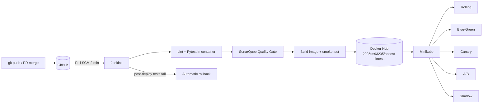

# Kubernetes deployment strategies (Assignment 2)

The application runs on **Minikube** on the lab VM (Rocky Linux 9.5, 2 CPU, 7.4 GB RAM)
behind the **NGINX Ingress Controller**. Every commit to `main` is built by Jenkins, pushed to
Docker Hub (`docker.io/2025tm93235/aceest-fitness`) and deployed with five strategies. If the
post-deploy tests fail, Jenkins rolls the deployment back to the last stable version.



## Layout

| File | Contents |
| --- | --- |
| `k8s/00-namespace.yaml` | Namespace `aceest` |
| `k8s/01-storage.yaml` | PVC `aceest-data`: one SQLite file shared by all pods and versions |
| `k8s/10-rolling-update.yaml` | `aceest-rolling` (2 replicas, maxSurge 1, maxUnavailable 0) |
| `k8s/20-blue-green.yaml` | `aceest-blue`, `aceest-green`, live Service `aceest-bluegreen`, preview Service `aceest-bluegreen-preview` |
| `k8s/30-stable.yaml` | `aceest-stable`: production version for the canary, A/B and shadow hosts |
| `k8s/31-canary.yaml` | `aceest-canary`: weighted share of `canary.aceest.local` |
| `k8s/32-ab-variant-b.yaml` | `aceest-variant-b`: A/B variant B |
| `k8s/33-shadow.yaml` | `aceest-shadow`: receives mirrored traffic |
| `k8s/40-ingress.yaml` | Host-based routing, canary weight, A/B header/cookie, traffic mirroring |
| `k8s/deploy.sh` | `setup`, `deploy`, `promote`, `rollback`, `status` |
| `deploy_tests/` | Post-deploy checks run inside the test container |

## Host names

Add the hosts to `/etc/hosts` on the VM (`$(minikube ip)` is usually `192.168.49.2`):

```bash
echo "$(sudo -u jenkins minikube ip) aceest.local rolling.aceest.local bluegreen.aceest.local bluegreen-preview.aceest.local canary.aceest.local ab.aceest.local shadow.aceest.local" | sudo tee -a /etc/hosts
```

| URL | Strategy | What you see |
| --- | --- | --- |
| http://aceest.local | Stable (production) | Current stable version |
| http://rolling.aceest.local | Rolling update | Newest version after a zero-downtime rollout |
| http://bluegreen.aceest.local | Blue-green (live) | The live colour |
| http://bluegreen-preview.aceest.local | Blue-green (idle) | The idle colour, tested before the switch |
| http://canary.aceest.local | Canary | Stable, with `CANARY_WEIGHT`% (default 20%) going to the canary |
| http://ab.aceest.local | A/B testing | A = stable; B with header `X-Variant: B` or cookie `ab_variant=always` |
| http://shadow.aceest.local | Shadow | Stable answers; every request is mirrored to the shadow version |

The page footer and `GET /version` show `version · track · pod` (from release 1.1.0), so it is
always visible which version answered.

## Strategies and rollback

| Strategy | How it works | Rollback |
| --- | --- | --- |
| Rolling update | `kubectl set image`; pods replaced one by one, readiness probe gates traffic | `kubectl rollout undo` (automatic if the rollout fails) |
| Blue-green | New version goes to the idle colour, is tested through the preview host, then the live Service selector switches | Switch the selector back to the previous colour (instant) |
| Canary | New version on `aceest-canary`; ingress `canary-weight` sends a share of traffic; `promote` moves it to stable | Weight to 0 and `rollout undo` |
| A/B testing | Variant B chosen by request attributes (header/cookie), not by chance | `rollout undo` of variant B |
| Shadow | `mirror-target` copies each request to the shadow version; its responses are discarded | `rollout undo` of the shadow |

Jenkins records which strategies a build changed (`reports/deployed-strategies.txt`). When the
deploy step or the post-deploy tests fail, it rolls back exactly those, newest first.

## Manual commands (run as the jenkins user)

```bash
K() { sudo -u jenkins kubectl -n aceest "$@"; }
sudo -u jenkins bash k8s/deploy.sh status
sudo -u jenkins bash k8s/deploy.sh promote canary
sudo -u jenkins bash k8s/deploy.sh rollback blue-green
K get pods -o wide
K rollout history deployment/aceest-rolling
K logs deployment/aceest-shadow --tail=20       # mirrored requests
```

Demonstrations:

```bash
# Canary split (about 20% of responses from the new version)
for i in $(seq 1 20); do curl -s -H 'Host: canary.aceest.local' http://$(sudo -u jenkins minikube ip)/version; echo; done

# A/B: variant A vs variant B
curl -s http://ab.aceest.local/version
curl -s -H 'X-Variant: B' http://ab.aceest.local/version

# Shadow: users get stable, the shadow pod logs the mirrored request
curl -s http://shadow.aceest.local/version
sudo -u jenkins kubectl -n aceest logs deployment/aceest-shadow --tail=5

# Failed deployment -> automatic rollback (image that does not exist)
sudo -u jenkins ROLLOUT_TIMEOUT=60s bash k8s/deploy.sh deploy rolling docker.io/2025tm93235/aceest-fitness:does-not-exist
```

## Notes

- **Shared SQLite:** Minikube has a single node, so all pods can mount the same
  ReadWriteOnce volume and SQLite file locking works between them. A multi-node cluster would
  need a networked database instead.
- **Secrets:** `aceest-secrets` (session key, admin password) is created on the VM and is never
  stored in Git.
- **Resources:** 8 small pods (25m CPU / 96 MiB requested each) fit next to Jenkins and SonarQube
  on the 2-CPU VM.
